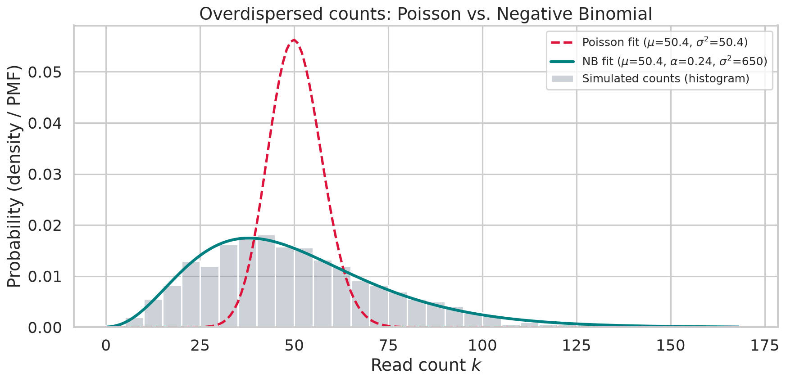

# stats-notes

Short, reproducible notes on statistics and probabilistic modelling, mostly with a
genomics / bioinformatics flavour. Each note is a self-contained Jupyter notebook:
a question, a simulation or analysis with a known ground truth, and an honest list of limitations.

## Notes

| # | Note | Topic | Key result |
|---|------|-------|-----------|
| 01 | [Poisson vs. Negative Binomial](notes/01_poisson_vs_nb.ipynb) | Overdispersion in RNA-seq read counts | Poisson test rejects ~59% of null experiments at nominal 5%; NB test stays at ~5% |

<!-- Add one row per new note. Keep numbering in sync with the file name in notes/. -->

## Preview: note 01



Variance of biological replicates exceeds the mean ($\sigma^2 = \mu + \alpha\mu^2$). The Poisson fit
(red, dashed) is far too narrow; the Negative Binomial (teal) matches the simulated counts. The note
then quantifies the consequences with tail probabilities, AIC (method of moments vs. maximum
likelihood) and a null-experiment simulation of false-positive rates.

## Repository layout

```
stats-notes/
├── README.md
├── requirements.txt
├── .gitignore
├── notes/        # one notebook per note: NN_short_name.ipynb
└── assets/       # figures exported by the notebooks (embedded in this README)
```

## Running the notes

This project uses [uv](https://docs.astral.sh/uv/) for deterministic environment and dependency management.

```bash
git clone https://github.com/meliheliguzel/stats-notes.git
cd stats-notes
uv sync
uv run jupyter lab notes/
```
To run the standalone Python simulation script directly without starting JupyterLab:
```Bash

uv run python notes/01_poisson_vs_nb.py
```
Run notebooks from inside notes/ (JupyterLab does this automatically when you open them); figures are written to ../assets/. All randomness is strictly seeded (SEED = 42), ensuring exact numerical and graphical reproducibility.


## Scope and honesty

These are didactic simulations, not production analyses. Each note states what it simplifies
(for example, a single gene with a shared mean, or a known dispersion). Corrections and
suggestions are welcome via issues.

## License

MIT (or choose your own).
